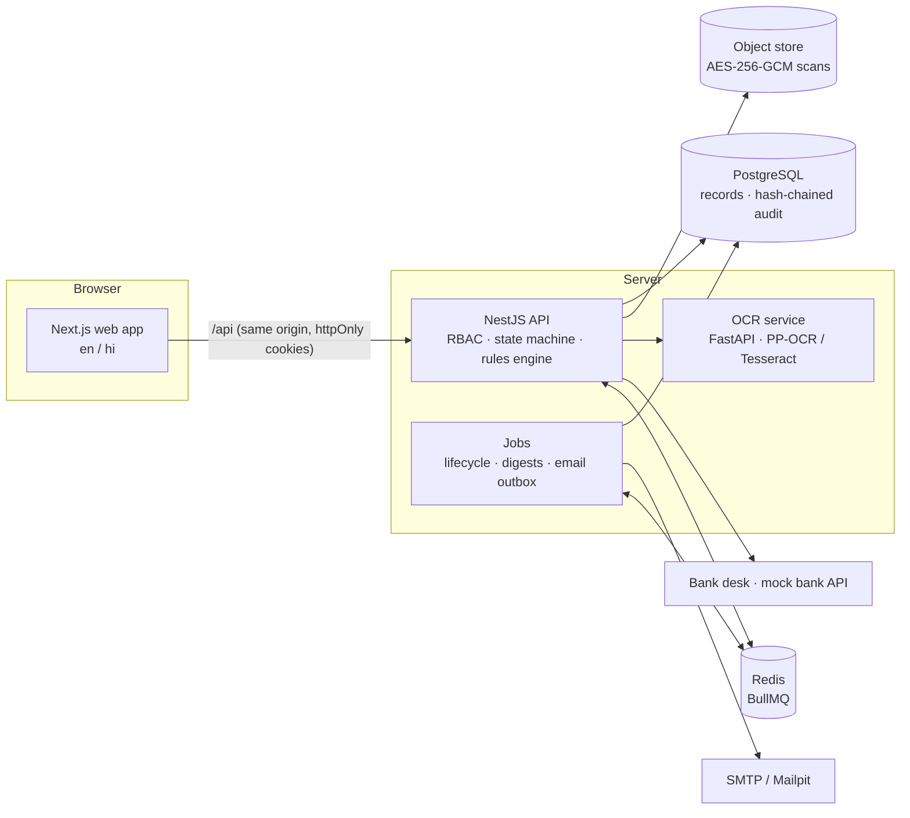

# NidhiSetu

**Verifiable Security Deposit / FDR Lifecycle Portal** — Smart India Hackathon 2026, PS **SIH26265**
(AICTE, Ministry of Education · Smart Automation · Software).

Institutions approved by AICTE keep a security deposit, usually a Fixed Deposit Receipt (FDR) pledged
in AICTE's favour. Today these are tracked on paper and spreadsheets: values are typed in by hand,
nobody can tell whether the bank ever confirmed them, renewals are missed, and releases depend on
whoever remembers the file.

NidhiSetu keeps **one verifiable record per deposit**:

- every value carries its **source and trust level** — declared by the institution → read by OCR →
  verified by an officer → confirmed by the bank — and disagreements between sources are flagged;
- each deposit moves through an enforced **lifecycle** (submission → scrutiny → bank confirmation →
  active → renewal / release) with SLAs, reminders and escalations;
- every action lands in a **hash-chained, append-only audit trail**;
- releases need a passing **precondition checklist** and **two different people** (maker–checker).

It records and verifies money; **it never moves money**. All data in this repository is fictional, and
every regulatory value (amounts, tenures, exemption ages, reminder windows…) lives in a versioned rules
table seeded with placeholders marked `ASSUMPTION – verify against AICTE APH 2024-27`.

## How the problem statement is covered

| PS scenario                   | Where in NidhiSetu                                                                                                                            | Proven by                                   |
| ----------------------------- | --------------------------------------------------------------------------------------------------------------------------------------------- | ------------------------------------------- |
| New FDR submission            | Declaration form (optional OCR pre-fill), scan upload, submit → regional officer's scrutiny queue                                             | `e2e/01-new-fdr-submission.spec.ts`         |
| Validity tracking             | Nightly lifecycle job: Valid / Expiring soon / Matured / Overdue renewal; dashboards and filters                                              | `e2e/02-validity-tracking.spec.ts`          |
| Approaching maturity          | Reminders at configurable offsets (90/60/30/7 days), in-app + email, escalation ladder when ignored                                           | `e2e/03-approaching-maturity.spec.ts`       |
| Renewal                       | Replacement FDR linked into a renewal chain; the old one stays held until the bank confirms the new one                                       | `e2e/04-renewal.spec.ts`                    |
| Discrepancy identification    | 10 automatic rules (source mismatch, amount below requirement, duplicate FDR / scan, lien, IFSC…) + officer-raised; respond / resolve / waive | `e2e/05-discrepancy-identification.spec.ts` |
| Authorised release processing | Precondition checklist, recommend (maker) → approve (checker) → finance records execution                                                     | `e2e/06-authorised-release.spec.ts`         |
| Legacy records                | Bulk upload of physical-FDR scans (ZIP), OCR drafts, officer review, reconciliation report                                                    | `apps/api/test/ocr-legacy.test.ts`          |

## Architecture



| Path              | What                                                                     |
| ----------------- | ------------------------------------------------------------------------ |
| `apps/api`        | NestJS API: Prisma, auth + MFA, RBAC, audit chain, rules, jobs, OCR glue |
| `apps/web`        | Next.js web app (English / हिन्दी), Playwright E2E in `apps/web/e2e`     |
| `packages/shared` | zod schemas, enums, lifecycle state machine, permissions, rule defaults  |
| `services/ocr`    | FastAPI OCR + field extraction ([README](services/ocr/README.md))        |
| `docs`            | Plan, decisions, security, DPDP, integration, demo script, limitations   |

## Quick start (Docker)

Prerequisites: Docker with Compose v2.24+, Node.js ≥ 22.12, pnpm 12.

```bash
cp .env.example .env           # optional on a dev machine (Compose has dev defaults)
docker compose up --build      # postgres, redis, object store, mailpit, ocr, api, web
pnpm install && pnpm seed      # loads the fictional demo portfolio (runs inside the api container)
```

| Service             | URL                            |
| ------------------- | ------------------------------ |
| Web app             | http://localhost:3000          |
| API docs (OpenAPI)  | http://localhost:4000/api/docs |
| Mailpit (dev email) | http://localhost:8025          |
| OCR service         | http://localhost:8000/health   |

`pnpm demo:reset` wipes and reseeds the demo (under 30 s). The seed replays five years of history
through the real services on a simulated clock: 60 institutions, ~130 deposits in every lifecycle and
validity state, renewal chains, releases at each stage, a duplicate-FDR fraud case and legacy records.

### Without Docker

`pnpm stack:up` starts portable PostgreSQL 16, Redis and Mailpit on the same ports (no admin rights
needed; data in `.data/`). Then:

```bash
pnpm install && pnpm build
pnpm seed
pnpm --filter @nidhisetu/api start      # API on :4000
pnpm --filter @nidhisetu/web dev        # web on :3000
cd services/ocr && python -m venv .venv && .venv/Scripts/pip install -r requirements.txt \
  && .venv/Scripts/python -m uvicorn app.main:app --port 8000   # optional OCR
```

## Demo accounts

All accounts are fictional; the password for every account is **`NidhiSetu@2026`**. Officers sign in
with a TOTP code: `pnpm demo:otp <email>` prints the current one (or add the secret printed by
`pnpm seed` to any authenticator app).

| Role                      | Email                               | Scope                           |
| ------------------------- | ----------------------------------- | ------------------------------- |
| Institution               | `institution@demo.nidhisetu.local`  | Sahyadri Heights Inst. of Tech. |
| Institution               | `institution2@demo.nidhisetu.local` | Satpura Kshetra Tech. Campus    |
| Regional officer          | `ro.north@demo.nidhisetu.local`     | Northern Region                 |
| Regional officer          | `ro.west@demo.nidhisetu.local`      | Western Region                  |
| Regulation bureau officer | `bureau@demo.nidhisetu.local`       | National                        |
| Competent authority       | `authority@demo.nidhisetu.local`    | National (approves releases)    |
| Finance officer           | `finance@demo.nidhisetu.local`      | National (records execution)    |
| Bank desk                 | `bank.sbi@demo.nidhisetu.local`     | State Bank of India             |
| Bank desk                 | `bank.hdfc@demo.nidhisetu.local`    | HDFC Bank                       |
| Auditor                   | `auditor@demo.nidhisetu.local`      | Read-only, audit verification   |
| System administrator      | `admin@demo.nidhisetu.local`        | Users, rules, demo clock        |

Real bank names appear only as labels; institutions, people, FDR numbers and amounts are made up.
A 10-minute walkthrough is in **[docs/DEMO.md](docs/DEMO.md)**.

## Tests

| Command                                      | What it runs                                                                                                                    |
| -------------------------------------------- | ------------------------------------------------------------------------------------------------------------------------------- |
| `pnpm test`                                  | Unit + integration tests (API against a throwaway `*_test` database, shared, web i18n)                                          |
| `pnpm --filter @nidhisetu/api test:coverage` | Domain logic coverage (≈97 % statements; CI gate 80 %)                                                                          |
| `pnpm e2e`                                   | Playwright, one spec per PS scenario (needs the stack running; resets demo data). `PW_CHANNEL=msedge` uses an installed browser |
| `pnpm load-test`                             | 10 000 active deposits in a separate DB; the lifecycle job must finish in < 60 s (≈4 s here)                                    |
| `pnpm tamper`                                | Database refuses an audit edit; a privileged edit is caught by the chain, a full rewrite by the signed anchors                  |
| `cd services/ocr && pytest`                  | OCR extraction, including all 10 synthetic samples                                                                              |
| `pnpm lint && pnpm typecheck`                | ESLint (type-aware) and TypeScript strict across the workspace                                                                  |

The RBAC matrix test discovers every API route, checks it declares an access rule and that each of the
8 roles gets 403 exactly where the permission table says so.

## Documentation

- [docs/DEMO.md](docs/DEMO.md) — guided demo
- [docs/PLAN.md](docs/PLAN.md) — architecture and phase checklist
- [docs/DECISIONS.md](docs/DECISIONS.md) — design decisions and assumptions
- [docs/SECURITY.md](docs/SECURITY.md) — security controls
- [docs/DPDP.md](docs/DPDP.md) — personal data, retention, DPDP Act
- [docs/INTEGRATION.md](docs/INTEGRATION.md) — bank, AICTE portal, SMS and OCR integration points
- [docs/KNOWN_LIMITATIONS.md](docs/KNOWN_LIMITATIONS.md) — what is not done yet, and the roadmap
