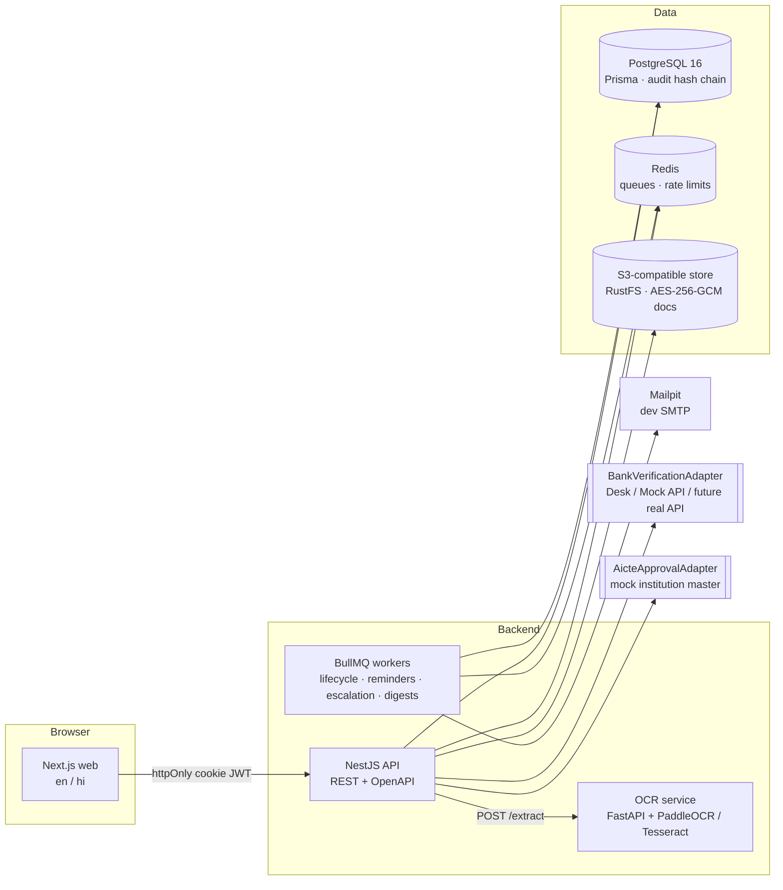

# NidhiSetu — Build Plan

SIH 2026 · PS **SIH26265** "Streamline of security deposit / FDR portal" · AICTE (MoE) · Smart Automation · Software.

> **Principle:** the portal _records and verifies_ money; it never _moves_ money. All regulatory numbers live in
> a versioned rules table, never in code. All seed data is fictional.

---

## 1. Architecture



### Key design points

| Concern          | Approach                                                                                                                                                                                            |
| ---------------- | --------------------------------------------------------------------------------------------------------------------------------------------------------------------------------------------------- |
| Field provenance | `FieldAssertion` rows (DECLARED → OCR_EXTRACTED → OFFICER_VERIFIED → BANK_CONFIRMED). Effective value = highest-trust assertion; disagreement ⇒ `MISMATCH` + auto discrepancy.                      |
| Lifecycle        | One state machine in `packages/shared`, enforced by the API (illegal transition ⇒ HTTP 409). Validity status (`VALID / EXPIRING_SOON / MATURED / OVERDUE_RENEWAL`) is _derived_ from dates + clock. |
| Time             | A single `Clock` service. With `DEMO_MODE=true`, `SYS_ADMIN` can set a simulated "today" used by every rule, job and dashboard.                                                                     |
| Rules            | `Rule` rows: `{code, type, version, json, effective_from, source}`. Seeded with `"source": "ASSUMPTION – verify against AICTE APH 2024-27"`.                                                        |
| Authorisation    | Role guard + **query-level** region/institution/bank scoping in a single `ScopeService` used by every repository query. Maker-checker enforced in the domain layer.                                 |
| Audit            | Append-only `audit_events`, `hash = sha256(prev_hash + canonical_json(event))`; DB trigger blocks UPDATE/DELETE; admin "Verify chain".                                                              |
| Documents        | Encrypted by the API with AES-256-GCM before upload; sha256 of plaintext stored for duplicate detection; downloads via short-lived signed tokens, each logged.                                      |
| Integration      | Adapter interfaces (`BankVerificationAdapter`, `AicteApprovalAdapter`, `SmsAdapter`, `OcrClient`) with mock implementations; OpenAPI at `/api/docs`.                                                |

---

## 2. Folder structure

```
.
├── apps/
│   ├── api/                 NestJS API (ESM)
│   │   ├── prisma/          schema, migrations, SQL (audit trigger)
│   │   ├── src/
│   │   │   ├── domain/      pure logic: state machine glue, trust, rules engine, discrepancy rules,
│   │   │   │                validity, maker-checker, audit hashing (≥80 % coverage target)
│   │   │   ├── modules/     auth, users, institutions, instruments, documents, scrutiny,
│   │   │   │                discrepancies, bank-desk, rules, lifecycle, renewals, releases,
│   │   │   │                notifications, dashboard, reports, metrics, legacy, audit, admin
│   │   │   ├── adapters/    bank, aicte, sms, ocr, storage, mail
│   │   │   ├── jobs/        BullMQ processors
│   │   │   └── common/      guards, interceptors, clock, scope, config, zod pipe
│   │   ├── scripts/         seed, demo-reset, load-seed, tamper-audit
│   │   └── test/            integration tests (Supertest)
│   └── web/                 Next.js App Router
│       ├── src/app/         [locale]/(roles)/… pages
│       ├── src/components/  ui (shadcn), trust badges, timelines, viewers
│       ├── messages/        en.json, hi.json
│       └── e2e/             Playwright specs (one per PS scenario)
├── packages/shared/         zod schemas, enums, state machine, types
├── services/ocr/            FastAPI OCR + rule-based extraction + sample generator
├── infra/                   postgres init SQL, other infra config
├── docs/                    PLAN, DECISIONS, INTEGRATION, SECURITY, DPDP, DEMO, KNOWN_LIMITATIONS
├── docker-compose.yml
└── .github/workflows/ci.yml
```

---

## 3. PS capability → module map

| #   | PS capability                                                   | Module(s)                                            | Phase    |
| --- | --------------------------------------------------------------- | ---------------------------------------------------- | -------- |
| 1   | Centralised repository                                          | institutions, instruments, search                    | 2, 8     |
| 2   | Digital document management                                     | documents, storage adapter                           | 2        |
| 3   | Verification & discrepancy detection (institution vs bank data) | scrutiny, field assertions, discrepancies, bank-desk | 3, 4     |
| 4   | Validity & maturity tracking                                    | lifecycle job, validity derivation, clock            | 5        |
| 5   | Renewal & replacement monitoring                                | renewals                                             | 6        |
| 6   | Release / refund workflow                                       | releases (maker-checker, finance execution)          | 7        |
| 7   | Alerts & escalation                                             | notifications, reminders, escalation, digests        | 5        |
| 8   | Dashboard & reports                                             | dashboard, work queues, reports, metrics             | 8        |
| 9   | Audit trail & RBAC                                              | audit, auth, guards, scope                           | 1        |
| 10  | Integration & data security                                     | adapters, OpenAPI, hardening, DPDP                   | 4, 9, 10 |

PS test scenarios → Playwright specs (Phase 11): _new FDR submission_, _validity tracking_, _approaching maturity_,
_renewal_, _discrepancy identification_, _authorized release processing_.

---

## 4. Phase checklist

### Phase 0 — Scaffold ✅

- [x] pnpm workspaces + Turborepo; strict shared `tsconfig.base.json` (ESM / NodeNext)
- [x] `packages/shared` with zod and a first shared schema + test
- [x] `apps/api` NestJS 12 skeleton, `/api/health`, Vitest + SWC, Supertest
- [x] `apps/web` Next.js 16 + Tailwind 4 skeleton, health status page, Vitest
- [x] `services/ocr` FastAPI skeleton, pytest, ruff
- [x] `docker-compose.yml`: postgres, redis, object store, mailpit, ocr, api, web (+ Dockerfiles)
- [x] ESLint (type-aware) + Prettier; CI workflow (TS, Python, compose validation)
- [x] `.env.example`, `docs/PLAN.md`, `docs/DECISIONS.md`

### Phase 1 — Data, auth, RBAC, audit ✅

- [x] Prisma schema for all entities (§6.1) + migrations; shared enums
- [x] Lifecycle state machine in `packages/shared` + unit tests
- [x] Auth: argon2id passwords, JWT in httpOnly cookies, rotating refresh tokens, logout, lockout
- [x] TOTP MFA (mandatory except INSTITUTION_USER, forced enrolment), AES-GCM encrypted secrets
- [x] Default-deny permission guard + permissions matrix; query-level region/institution/bank scoping
- [x] Hash-chained `audit_events` + UPDATE/DELETE/TRUNCATE-blocking triggers + chain verification
- [x] CSRF double-submit, helmet, rate limiting, OpenAPI at `/api/docs`
- [x] Web: login + MFA/enrolment screens, role-aware shell, en/hi from day one
- [x] Seed: regions, 8 banks, 60 institutions, rules v1, one demo user per role; `demo:otp` helper
- [x] Tests: state machine, scoping, audit chain (incl. tamper + concurrency), auth/MFA, RBAC

### Phase 2 — Institution module ✅

- [x] Declare / edit / delete DRAFT instruments; every declared value is a DECLARED assertion
- [x] Effective values, trust score and mismatch count recomputed from assertions on every change
- [x] Shared state-machine enforcement with optimistic concurrency, transition log, audit (409 on illegal moves)
- [x] Documents: magic-byte type sniffing, size limit, sha256, AES-256-GCM before storage (fs or S3),
      versioning per type, signed short-lived download/preview links, every download audited
- [x] Server-computed `allowedActions` per role × state × separation of duties
- [x] Web: instrument list (search + filters in the URL), declaration form, detail page with trust
      badges, assertion history, documents, timeline
- [x] Tests: trust/provenance, file sniffing, allowed actions, full institution flow, scoping (404 not 403)

### Phase 3 — Scrutiny ✅

- [x] Officer workspace: side-by-side FDR scan viewer + field list with trust badges
- [x] One-click "verify field" (OFFICER_VERIFIED) and "correct" (officer's reading of the original)
- [x] "Mark officer-verified" requires every key field verified and every discrepancy closed
- [x] Discrepancy rules engine — all nine rules of §6.3, each enabled/severity-configurable, with
      stable keys (no duplicates on re-evaluation; officer-closed findings never re-raised)
- [x] Auto-resolve when a condition clears; duplicate-FDR fraud signal flags both instruments
- [x] Versioned rules resolved as of the demo clock (`RulesService`)
- [x] Discrepancy threads: institution replies (→ RESPONDED), officer resolves/waives with a reason,
      institution sends the instrument back; reject with a mandatory note
- [x] Web: scrutiny queue, discrepancies queue, discrepancy panel, data-driven action bar
- [x] Tests: rules engine versions, all discrepancy rules, full scrutiny loop, role/scope checks

### Phase 4 — Bank Confirmation Desk ✅

- [x] `BankVerificationAdapter` with `BankDeskAdapter` (manual) and `MockBankApiAdapter` (latency, failure
      rate, demo trap numbers); `BANK_ADAPTER=desk|mock-api|auto`
- [x] RO "send to bank" (OFFICER_VERIFIED → BANK_CONFIRMATION_PENDING) with a snapshot of AICTE's values
- [x] Bank officers see only their bank's queue; confirm/deny existence, lien, maturity, auto-renewal,
      principal; optional signed letter stored as evidence
- [x] Response → BANK_CONFIRMED assertions; all agree → BANK_CONFIRMED → ACTIVE; otherwise HIGH
      `BANK_DENIED` discrepancy and back to UNDER_SCRUTINY; failed API calls retryable
- [x] `docs/INTEGRATION.md` (real bank API, NeSL-style registry)
- [x] Web: mobile-first bank desk + answer form, bank panel and "send to bank" on the instrument
- [x] Tests: response evaluation, adapters, desk/API/deny/retry flows, bank scoping

### Phase 5 — Rules, lifecycle, alerts, demo clock ✅

- [x] Versioned rules API + admin UI (JSON editor, effective dates, source, history, audit);
      rule codes as data, placeholders flagged "verify"
- [x] Lifecycle job: validity (VALID / EXPIRING_SOON / MATURED / OVERDUE_RENEWAL) from dates + clock;
      reminders T-90/60/30/7 idempotent per instrument per offset (unique key; a clock jump records
      every crossed offset but announces only the nearest); set-based for large volumes
- [x] Escalation ladder from SLA rules (one level per missed SLA period, 0-day SLAs weekly),
      auto-resolution, scoped escalation list
- [x] Notifications: in-app + email outbox (sent after commit, Mailpit in dev) + SMS stub with
      masked numbers; hooks on submission, discrepancies, responses, bank requests/answers, activation
- [x] Daily per-officer digest; BullMQ schedules (lifecycle 00:30 IST, digest 08:00, outbox every
      minute) when Redis is configured, admin "run now" endpoints otherwise
- [x] Demo clock (admin UI: +7/30/60/90/365 days, set date, reset) — runs the lifecycle job on change,
      refused when DEMO_MODE=false
- [x] Web: demo clock, rules, notifications, escalations, user management
- [x] Tests: validity, reminder idempotency, escalation levels, clock/validity/reminder/escalation
      flow, rule publishing, digest, RBAC on admin endpoints

### Phase 6 — Renewal chain ✅

- [x] `POST /instruments/:id/renewal` creates a DRAFT linked through `replacesInstrumentId` (one live
      replacement at a time; rejected attempts are detached so a new one can be filed)
- [x] Submitting the replacement moves the old instrument ACTIVE → RENEWAL_PENDING (validity stays
      MATURED, never OVERDUE, while the renewal is in flight)
- [x] Old instrument closes (RENEWAL_PENDING → RENEWED) only when the replacement is bank-confirmed;
      a rejected replacement returns the old one to ACTIVE
- [x] Chain timeline (oldest → newest) on every instrument of the chain; renewals queue
- [x] Web: renewal form pre-filled with the next term, renewals page
- [x] Tests: three-deep chain with a rejected attempt, scoping and state guards

### Phase 7 — Release workflow ✅

- [x] Institution requests release (ACTIVE → RELEASE_REQUESTED); configurable precondition checklist
      evaluated automatically and stored (open discrepancies, bank confirmation, NOC, renewal in flight,
      minimum holding period, deposit no longer required)
- [x] RO/Bureau recommend (checklist re-evaluated, must pass) or decline (→ RELEASE_REJECTED → ACTIVE)
- [x] Competent authority approves or rejects; maker-checker enforced in the domain layer
      (recommender ≠ approver ≠ requester) and in allowed actions; SYS_ADMIN has no approval permission
- [x] Finance records execution reference + date (portal never moves money) → RELEASED
- [x] Status timeline visible to the institution; releases queue; notifications at every step
- [x] Tests: checklist rules, maker-checker, full flow, segregation of duties, decline, scoping

### Phase 8 — Dashboard & reports

- [ ] KPI cards, charts (region/bank/status), work queues, global search + saved filters
- [ ] Reports CSV/XLSX/PDF; outcome metrics page with admin baselines

### Phase 9 — OCR & legacy digitisation

- [ ] `/extract` with PaddleOCR (Tesseract fallback) + rule-based extraction; 10 synthetic samples
- [ ] Bulk legacy upload (ZIP / multi-file), review drafts, reconciliation report

### Phase 10 — i18n, a11y, security

- [ ] en/hi for all strings; WCAG 2.1 AA pass; mobile for institution + bank roles
- [ ] Rate limit, helmet, CSRF-safe cookies, PII masking in logs
- [ ] `docs/SECURITY.md`, `docs/DPDP.md`

### Phase 11 — Seed, E2E, perf, docs

- [ ] `pnpm seed` (60 institutions, ~150 instruments, 8 banks, users per role), `pnpm demo:reset` < 30 s
- [ ] Playwright E2E per PS scenario; load seed (10k instruments, reminder job < 60 s)
- [ ] README, `docs/DEMO.md`; harsh-judge self-review; `docs/KNOWN_LIMITATIONS.md`
