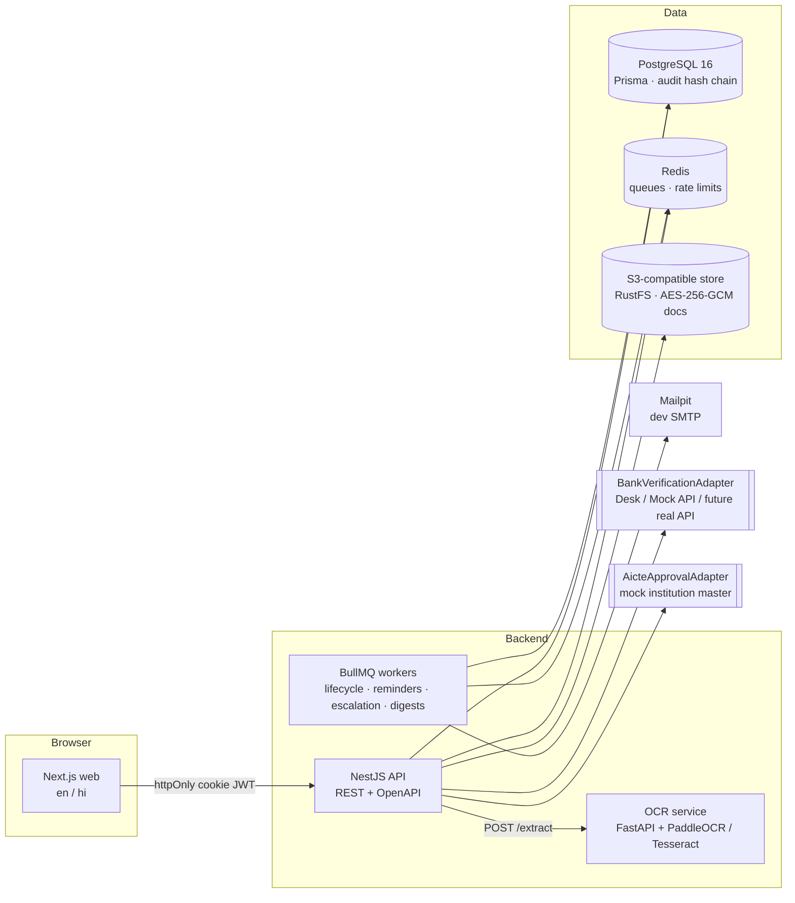

# NidhiSetu — Build Plan

SIH 2026 · PS **SIH26265** "Streamline of security deposit / FDR portal" · AICTE (MoE) · Smart Automation · Software.

> **Principle:** the portal _records and verifies_ money; it never _moves_ money. All regulatory numbers live in
> a versioned rules table, never in code. All seed data is fictional.

---

## 1. Architecture



### Key design points

| Concern          | Approach                                                                                                                                                                                            |
| ---------------- | --------------------------------------------------------------------------------------------------------------------------------------------------------------------------------------------------- |
| Field provenance | `FieldAssertion` rows (DECLARED → OCR_EXTRACTED → OFFICER_VERIFIED → BANK_CONFIRMED). Effective value = highest-trust assertion; disagreement ⇒ `MISMATCH` + auto discrepancy.                      |
| Lifecycle        | One state machine in `packages/shared`, enforced by the API (illegal transition ⇒ HTTP 409). Validity status (`VALID / EXPIRING_SOON / MATURED / OVERDUE_RENEWAL`) is _derived_ from dates + clock. |
| Time             | A single `Clock` service. With `DEMO_MODE=true`, `SYS_ADMIN` can set a simulated "today" used by every rule, job and dashboard.                                                                     |
| Rules            | `Rule` rows: `{code, type, version, json, effective_from, source}`. Seeded with `"source": "ASSUMPTION – verify against AICTE APH 2024-27"`.                                                        |
| Authorisation    | Role guard + **query-level** region/institution/bank scoping in a single `ScopeService` used by every repository query. Maker-checker enforced in the domain layer.                                 |
| Audit            | Append-only `audit_events`, `hash = sha256(prev_hash + canonical_json(event))`; DB trigger blocks UPDATE/DELETE; admin "Verify chain".                                                              |
| Documents        | Encrypted by the API with AES-256-GCM before upload; sha256 of plaintext stored for duplicate detection; downloads via short-lived signed tokens, each logged.                                      |
| Integration      | Adapter interfaces (`BankVerificationAdapter`, `AicteApprovalAdapter`, `SmsAdapter`, `OcrClient`) with mock implementations; OpenAPI at `/api/docs`.                                                |

---

## 2. Folder structure

```
.
├── apps/
│   ├── api/                 NestJS API (ESM)
│   │   ├── prisma/          schema, migrations, SQL (audit trigger)
│   │   ├── src/
│   │   │   ├── domain/      pure logic: state machine glue, trust, rules engine, discrepancy rules,
│   │   │   │                validity, maker-checker, audit hashing (≥80 % coverage target)
│   │   │   ├── modules/     auth, users, institutions, instruments, documents, scrutiny,
│   │   │   │                discrepancies, bank-desk, rules, lifecycle, renewals, releases,
│   │   │   │                notifications, dashboard, reports, metrics, legacy, audit, admin
│   │   │   ├── adapters/    bank, aicte, sms, ocr, storage, mail
│   │   │   ├── jobs/        BullMQ processors
│   │   │   └── common/      guards, interceptors, clock, scope, config, zod pipe
│   │   ├── scripts/         seed, demo-reset, load-seed, tamper-audit
│   │   └── test/            integration tests (Supertest)
│   └── web/                 Next.js App Router
│       ├── src/app/         [locale]/(roles)/… pages
│       ├── src/components/  ui (shadcn), trust badges, timelines, viewers
│       ├── messages/        en.json, hi.json
│       └── e2e/             Playwright specs (one per PS scenario)
├── packages/shared/         zod schemas, enums, state machine, types
├── services/ocr/            FastAPI OCR + rule-based extraction + sample generator
├── infra/                   postgres init SQL, other infra config
├── docs/                    PLAN, DECISIONS, INTEGRATION, SECURITY, DPDP, DEMO, KNOWN_LIMITATIONS
├── docker-compose.yml
└── .github/workflows/ci.yml
```

---

## 3. PS capability → module map

| #   | PS capability                                                   | Module(s)                                            | Phase    |
| --- | --------------------------------------------------------------- | ---------------------------------------------------- | -------- |
| 1   | Centralised repository                                          | institutions, instruments, search                    | 2, 8     |
| 2   | Digital document management                                     | documents, storage adapter                           | 2        |
| 3   | Verification & discrepancy detection (institution vs bank data) | scrutiny, field assertions, discrepancies, bank-desk | 3, 4     |
| 4   | Validity & maturity tracking                                    | lifecycle job, validity derivation, clock            | 5        |
| 5   | Renewal & replacement monitoring                                | renewals                                             | 6        |
| 6   | Release / refund workflow                                       | releases (maker-checker, finance execution)          | 7        |
| 7   | Alerts & escalation                                             | notifications, reminders, escalation, digests        | 5        |
| 8   | Dashboard & reports                                             | dashboard, work queues, reports, metrics             | 8        |
| 9   | Audit trail & RBAC                                              | audit, auth, guards, scope                           | 1        |
| 10  | Integration & data security                                     | adapters, OpenAPI, hardening, DPDP                   | 4, 9, 10 |

PS test scenarios → Playwright specs (Phase 11): _new FDR submission_, _validity tracking_, _approaching maturity_,
_renewal_, _discrepancy identification_, _authorized release processing_.

---

## 4. Phase checklist

### Phase 0 — Scaffold ✅

- [x] pnpm workspaces + Turborepo; strict shared `tsconfig.base.json` (ESM / NodeNext)
- [x] `packages/shared` with zod and a first shared schema + test
- [x] `apps/api` NestJS 12 skeleton, `/api/health`, Vitest + SWC, Supertest
- [x] `apps/web` Next.js 16 + Tailwind 4 skeleton, health status page, Vitest
- [x] `services/ocr` FastAPI skeleton, pytest, ruff
- [x] `docker-compose.yml`: postgres, redis, object store, mailpit, ocr, api, web (+ Dockerfiles)
- [x] ESLint (type-aware) + Prettier; CI workflow (TS, Python, compose validation)
- [x] `.env.example`, `docs/PLAN.md`, `docs/DECISIONS.md`

### Phase 1 — Data, auth, RBAC, audit

- [ ] Prisma schema for all entities (§6.1) + migrations; shared enums
- [ ] Lifecycle state machine in `packages/shared` + unit tests
- [ ] Auth: argon2 passwords, JWT in httpOnly cookies, refresh, logout
- [ ] TOTP MFA (mandatory except INSTITUTION_USER), encrypted secrets
- [ ] RBAC guard + permissions matrix; query-level region/institution/bank scoping
- [ ] Hash-chained `audit_events` + UPDATE/DELETE-blocking trigger + chain verification
- [ ] Web: login + MFA screens, role-aware shell
- [ ] Tests: state machine, scoping, audit chain, RBAC allowed/forbidden

### Phase 2 — Institution module

- [ ] Submit/edit draft instrument, DECLARED assertions
- [ ] Document upload (type sniffing, size limit, sha256, AES-GCM, versioning), signed download, download audit
- [ ] Institution UI: my instruments, new instrument form, documents panel

### Phase 3 — Scrutiny

- [ ] Officer workspace: document viewer + field list with trust badges
- [ ] Verify field (OFFICER_VERIFIED), effective value + MISMATCH computation, trust score
- [ ] Discrepancy rules engine (§6.3) + discrepancy threads; institution response

### Phase 4 — Bank Confirmation Desk

- [ ] `BankVerificationAdapter`, `BankDeskAdapter`, `MockBankApiAdapter`
- [ ] Bank officer UI (own bank only), confirm/deny 4 checks + letter
- [ ] BANK_CONFIRMED assertions → ACTIVE; `docs/INTEGRATION.md`

### Phase 5 — Rules, lifecycle, alerts, demo clock

- [ ] Versioned rules + admin UI + audit
- [ ] Daily lifecycle job (idempotent reminders), validity status
- [ ] Notifications (in-app, email, SMS stub), escalation by SLA, daily digest
- [ ] Demo clock (disabled when `DEMO_MODE=false`)

### Phase 6 — Renewal chain

- [ ] Replacement linked via `replaces_instrument_id`; chain timeline; old closes on new BANK_CONFIRMED

### Phase 7 — Release workflow

- [ ] Request → auto checklist → recommend → approve (maker-checker) → finance execution; status timeline

### Phase 8 — Dashboard & reports

- [ ] KPI cards, charts (region/bank/status), work queues, global search + saved filters
- [ ] Reports CSV/XLSX/PDF; outcome metrics page with admin baselines

### Phase 9 — OCR & legacy digitisation

- [ ] `/extract` with PaddleOCR (Tesseract fallback) + rule-based extraction; 10 synthetic samples
- [ ] Bulk legacy upload (ZIP / multi-file), review drafts, reconciliation report

### Phase 10 — i18n, a11y, security

- [ ] en/hi for all strings; WCAG 2.1 AA pass; mobile for institution + bank roles
- [ ] Rate limit, helmet, CSRF-safe cookies, PII masking in logs
- [ ] `docs/SECURITY.md`, `docs/DPDP.md`

### Phase 11 — Seed, E2E, perf, docs

- [ ] `pnpm seed` (60 institutions, ~150 instruments, 8 banks, users per role), `pnpm demo:reset` < 30 s
- [ ] Playwright E2E per PS scenario; load seed (10k instruments, reminder job < 60 s)
- [ ] README, `docs/DEMO.md`; harsh-judge self-review; `docs/KNOWN_LIMITATIONS.md`
